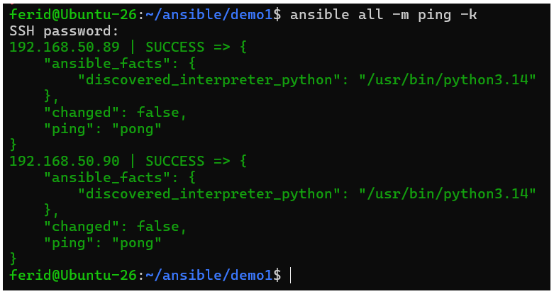
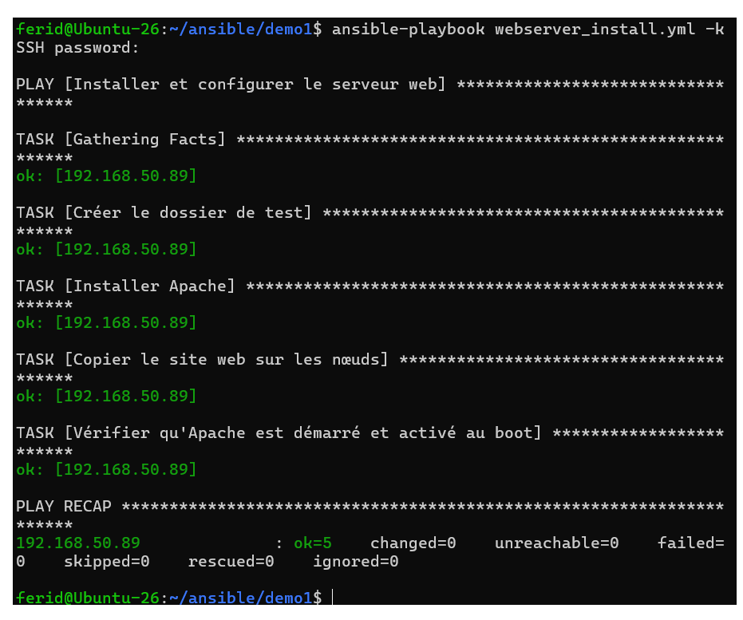
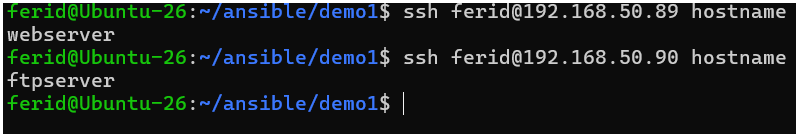
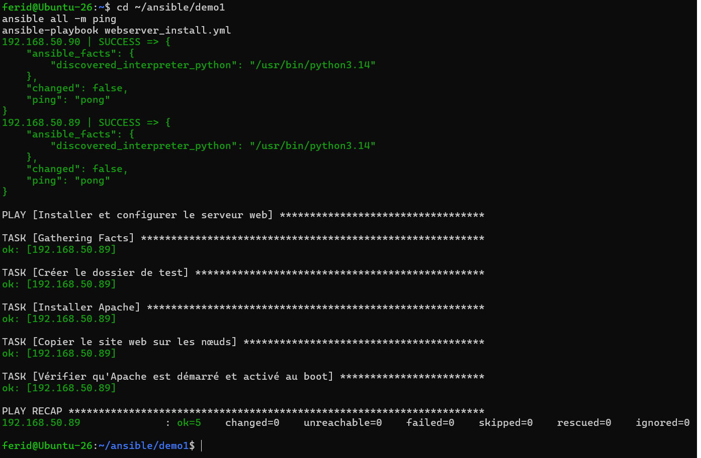
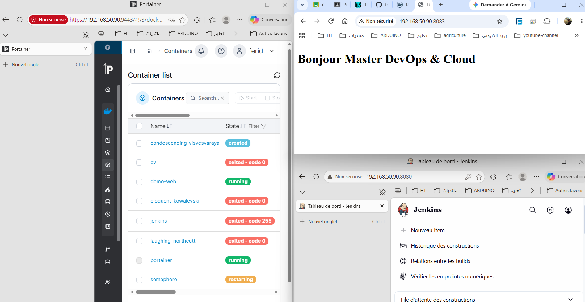
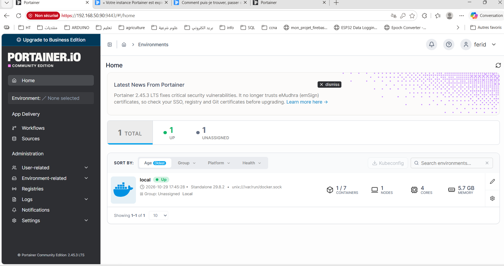

# TP4 : Bases d'Ansible (inventaire, playbooks, clés SSH, rôles)

**Auteur :** Ferid Saad
**Formation :** Master DevOps \& Cloud, ISET Tozeur

Ansible est un outil open source d'automatisation écrit en Python. Il est **sans agent** (agentless) : il utilise OpenSSH comme transport, donc les nœuds gérés n'ont besoin que d'un serveur SSH et de Python 3. Ses playbooks sont écrits en YAML.

## Objectifs pédagogiques

* Décrire l'architecture d'Ansible (nœud de contrôle, nœuds gérés, inventaire, modules)
* Écrire un inventaire, un fichier `ansible.cfg` et un premier playbook idempotent
* Passer d'une authentification SSH par mot de passe à une authentification par clé
* Automatiser l'installation de Jenkins, Docker, Portainer et d'un conteneur applicatif
* Réorganiser un playbook en rôles

## Vocabulaire

|Terme|Signification|
|-|-|
|Nœud de contrôle|Machine où Ansible est installé et depuis laquelle on lance `ansible` / `ansible-playbook`|
|Nœud géré|Hôte cible configuré par Ansible (sshd + Python 3 suffisent)|
|Inventaire|Liste des nœuds gérés, organisés en groupes|
|Module|Unité de travail (`apt`, `copy`, `file`, `service`…)|
|Tâche|Appel à un module avec un `name` lisible|
|Playbook|Fichier YAML contenant un ou plusieurs plays|
|Rôle|Ensemble réutilisable de tâches, handlers, fichiers, templates et variables|

## Architecture de l'environnement

* 1 VM Ubuntu Server 26.04 : **nœud de contrôle** Ansible
* 2 VM Ubuntu Server 26.04 : **nœuds gérés** (`webserver` et `ftpserver`)
* Même utilisateur (`devops`) avec droits sudo sur chaque VM, SSH actif

Installation d'Ansible sur le nœud de contrôle :

```bash
sudo apt update
sudo apt install -y ansible sshpass
ansible --version
```

## Structure du projet

```
demo1/
├── ansible.cfg
├── inventory.txt
├── index.html
├── webserver\_install.yml
├── Dockerfile
├── docker-compose.yml
├── site.yml                  # playbook à base de rôles
├── roles/
│   ├── jenkins\_install/
│   ├── docker\_portainer\_install/
│   └── container\_deployment/
└── captures/
```

## Partie 0 : Préparer l'environnement

Créer le dossier de projet et l'inventaire :

```bash
mkdir -p \~/ansible/demo1 \&\& cd \~/ansible/demo1
```

`inventory.txt` :

```ini
\[webserver]
192.168.50.89

\[ftpserver]
192.168.50.90

\[nodes:children]
webserver
ftpserver

\[nodes:vars]
ansible\_user=ferid
```

Vérifications :

```bash
ansible-inventory -i inventory.txt --graph
ansible all -i inventory.txt -m ping -k
```

Résultat attendu : `"ping": "pong"` avec `SUCCESS` sur les deux nœuds.


## Partie 1 : `ansible.cfg`

```ini
\[defaults]
inventory = ./inventory.txt
remote\_user = devops
host\_key\_checking = False
deprecation\_warnings = False
```

> `host\_key\_checking = False` est réservé au lab.

```bash
ansible all -m ping -k
ansible-config dump --only-changed
```

## Partie 2 : Premier playbook (`webserver\_install.yml`)

```yaml
---
- name: Installer et configurer le serveur web
  hosts: webserver
  become: true
  gather\_facts: true

  tasks:
    - name: Créer le dossier de test
      ansible.builtin.file:
        path: "/home/{{ ansible\_user }}/test"
        state: directory
        owner: "{{ ansible\_user }}"
        mode: '0755'

    - name: Installer Apache
      ansible.builtin.apt:
        name: apache2
        state: present
        update\_cache: true

    - name: Copier le site web sur les nœuds
      ansible.builtin.copy:
        src: index.html
        dest: /var/www/html/index.html
        owner: www-data
        group: www-data
        mode: '0644'

    - name: Vérifier qu'Apache est démarré et activé au boot
      ansible.builtin.service:
        name: apache2
        state: started
        enabled: true
```

`index.html` :

```html
<!doctype html>
<html lang="fr">
<head>
  <meta charset="utf-8">
  <title>Démo Ansible</title>
</head>
<body>
  <h1>Bonjour Master DevOps \& Cloud</h1>
</body>
</html>
```

Exécution :

```bash
ansible-playbook webserver\_install.yml --syntax-check
ansible-playbook webserver\_install.yml -k -K --check --diff
ansible-playbook webserver\_install.yml -k -K
curl http://192.168.50.89
```


**Idempotence :** un second passage doit afficher `changed=0` dans le `PLAY RECAP`.

## Partie 3 : Authentification par clé SSH

```bash
ssh-keygen -t ed25519 -C "ansible-control"
ssh-copy-id devops@192.168.1.66
ssh-copy-id devops@192.168.1.85
ansible-playbook webserver\_install.yml -K
```

Le mot de passe SSH n'est plus demandé (`-k` disparaît). `-K` reste nécessaire pour `sudo`.



Optionnel (lab uniquement) pour se passer de `-K` :

```bash
echo "devops ALL=(ALL) NOPASSWD:ALL" | sudo tee /etc/sudoers.d/devops
```

## Partie 4 : Playbook d'installation de conteneurs Docker

1. Créer une image Docker contenant `index.html` (`Dockerfile`)
2. Pousser l'image sur Docker Hub (réutilisée au TP5)
3. Écrire un playbook qui :

   * installe Jenkins
   * installe Docker
   * installe Portainer
   * crée un conteneur depuis l'image via `docker-compose.yml` (port web exposé)
4. Tester l'accès aux conteneurs

````

Service	Adresse
Conteneur web	http://192.168.50.90:8083
Jenkins	http://192.168.50.90:8080( user: ferid pwd: 07.....3)
Portainer	https://192.168.50.90:9443 (user: ferid pwd:1yT...tech..27)

````

> À défaut de compte Docker Hub, construire l'image sur chaque nœud avec `docker build`.



## Partie 5 : Le même playbook avec des rôles

Rôles à créer :

* `jenkins\_install`
* `docker\_portainer\_install`
* `container\_deployment`

```bash
mkdir -p roles
ansible-galaxy role init roles/jenkins\_install
ansible-galaxy role init roles/docker\_portainer\_install
ansible-galaxy role init roles/container\_deployment
```

Structure d'un rôle (seul `tasks/main.yml` est obligatoire) :

```
roles/jenkins\_install/
├── defaults/main.yml
├── files/
├── handlers/main.yml
├── meta/main.yml
├── tasks/main.yml
├── templates/
├── tests/
└── vars/main.yml
```

Relancer le playbook à base de rôles deux fois : le second passage doit afficher `changed=0`.

## Livrables (captures)

|Fichier|Contenu attendu|
|-|-|
|`captures/ping-pong.png`|`ansible all -m ping` avec SUCCESS / pong sur les 2 nœuds|
|`captures/playbook-run.png`|Premier passage de `webserver\_install.yml` + `curl` sur le nœud web|
|`captures/idempotence.png`|Deuxième passage avec `changed=0`|
|`captures/ssh-keys.png`|Exécution sans `-k` après `ssh-copy-id`|
|`captures/containers.png`|Jenkins, Portainer et le conteneur web accessibles dans le navigateur|
|`captures/roles-run.png`|Exécution du playbook à base de rôles|

## Conclusion

Ce TP a permis de maîtriser les bases d'Ansible : inventaire, configuration, playbooks idempotents, authentification par clé SSH, déploiement de services conteneurisés et organisation du code en rôles réutilisables.

